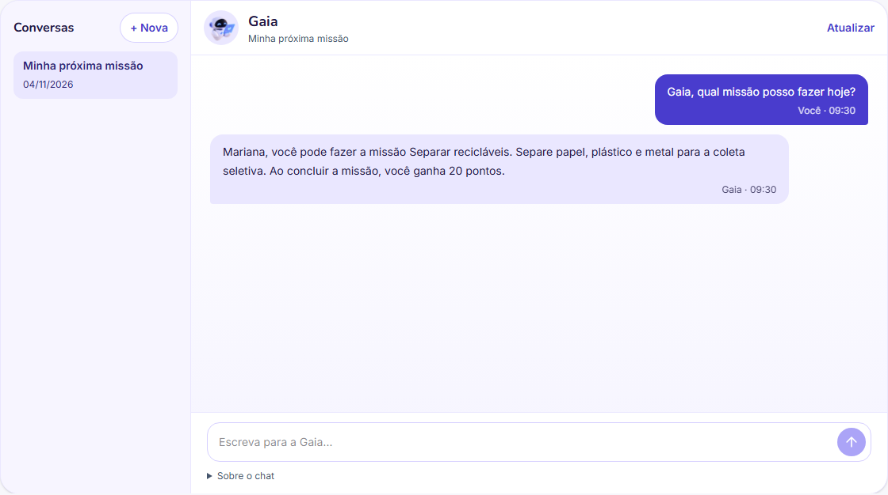
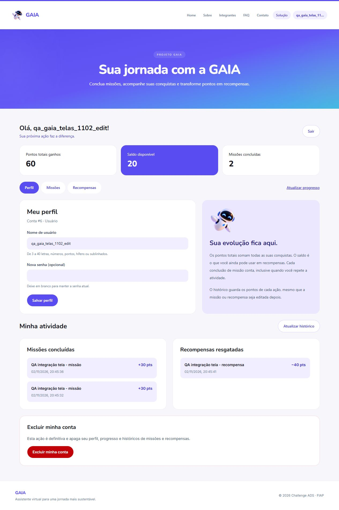
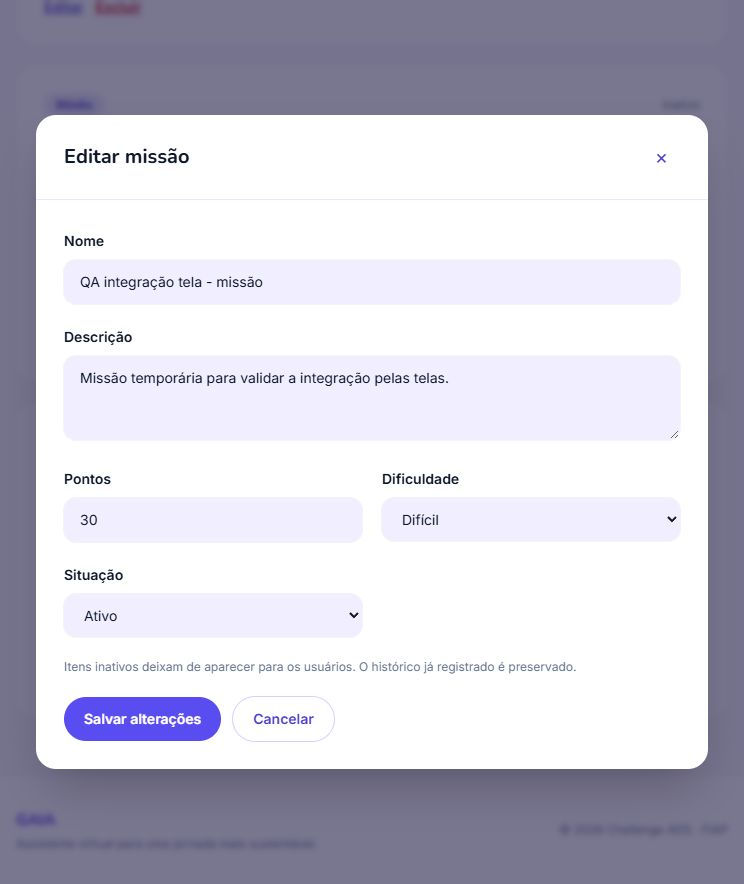
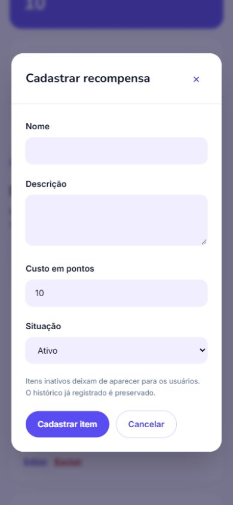

# GAIA — Assistente Virtual para a SoulUp


## Descrição do projeto

O **GAIA** é uma assistente virtual para o Challenge SoulUp da FIAP. Na área Solução, o usuário acompanha seu progresso, conclui missões sustentáveis, troca pontos por recompensas e conversa com a Gaia sobre sua jornada.

## Funcionalidades

- Navegação SPA entre todas as páginas;
- Cadastro, login por sessão e logout;
- Consulta, edição e exclusão da própria conta;
- Conclusão repetida de missões e resgate de recompensas;
- Chat com a Gaia e histórico de conversas;
- Progresso e históricos fornecidos pela API;
- Cadastro, edição, exclusão e desativação de missões/recompensas para administradores;
- Validação do formulário de contato;
- Página de integrantes;
- Layout responsivo para celulares e computadores;
- Página personalizada para endereços não encontrados.

## Imagens do projeto

**Chat com a Gaia**

Conversa de exemplo: Mariana pergunta qual missão pode fazer e a Gaia explica como ganhar pontos.



**Perfil e progresso**



**Edição do catálogo pelo administrador**



**Visualização no celular**



## Tecnologias utilizadas

- React;
- TypeScript;
- Vite;
- Tailwind CSS;
- React Router DOM;
- React Hook Form;
- Git e GitHub.

## Como usar

- **Repositório GitHub:** [GAIA-React](https://github.com/henriquemunizz/GAIA-React)
- **Aplicação publicada na Vercel:** [Acessar aplicação](https://gaia-react.vercel.app/)
- **API Java publicada:**  [Acessar API](https://gaia-api-sprint-4.vercel.app/)
- **Vídeo de apresentação no YouTube:** [Assistir ao vídeo](https://youtu.be/hf6ZWBWJSaQ)

### Pré-requisitos

- Node.js 22.18+ (ou 24+) e npm instalados;
- API Java em execução com acesso ao Oracle.

### Instalação

```bash
npm install
```

### Execução em ambiente de desenvolvimento

```bash
npm run dev
```

Abra [`http://localhost:5173`](http://localhost:5173). O Vite usa `strictPort`: se a porta estiver ocupada, encerra com erro em vez de mudar a origem. Reutilize o servidor existente ou libere a porta.

A URL padrão da API é `http://localhost:8080`. Para configurá-la, copie `.env.example` para `.env` e ajuste `VITE_API_URL`. Reinicie o Vite após mudar variáveis de ambiente.

### Verificação do projeto

```bash
npm run lint
npm test
npm run build
```

## Rotas

| Rota | Página |
| --- | --- |
| `/` | Home |
| `/sobre` | Sobre o projeto |
| `/integrantes` | Integrantes |
| `/faq` | Perguntas frequentes |
| `/contato` | Contato |
| `/solucao` | Login (ou Perfil, se autenticado) |
| `/solucao/cadastro` | Cadastro |
| `/solucao/perfil` | Própria conta, progresso e históricos |
| `/solucao/missoes` | Missões e administração do catálogo |
| `/solucao/recompensas` | Recompensas e administração do catálogo |
| `/solucao/chat` | Chat com a Gaia |
| `/assistente` | Redirecionamento para o chat |
| `/loja`, `/loja/:id` | Redirecionamento para recompensas |
| `/membros` | Redirecionamento para Integrantes |

## Estrutura de pastas

```text
public/
└── images/              # Imagens e screenshots usados na aplicação e no README

src/
├── components/          # Componentes reutilizáveis
├── context/             # Sessão e acesso ao progresso da solução
├── data/                # Dados dos integrantes
├── services/            # Requisições à API Java
├── pages/               # Páginas da aplicação
├── types/               # Interfaces TypeScript
├── App.tsx              # Rotas da aplicação
├── index.css            # Tailwind CSS e tema visual
└── main.tsx             # Entrada do React
```

## Integração com a API

A integração segue os controllers e DTOs em `gaia-api/src/main/java/br/com/fiap/api`. O front mantém a organização em componentes, páginas, tipos e serviços, usando `fetch`, hooks do React e React Hook Form.

### Sessão e origem local

- Na execução da API, configure `GAIA_FRONTEND_ORIGIN=http://localhost:5173` (também é o padrão do backend).
- Use `localhost` nos dois endereços; não misture com `127.0.0.1`.
- Todas as requisições usam `credentials: 'include'`. Não há Bearer Token nem credenciais em localStorage.
- O cookie `JSESSIONID` é gerenciado pelo navegador e é HttpOnly. A sessão é recuperada por `GET /usuarios/me` ao recarregar a página.
- `401` leva ao login; `403` exibe a negativa da API e reconsulta o perfil. A autorização continua no backend.
- CORS permite a origem exata com credenciais. Ao mudar a porta do Vite, altere também `GAIA_FRONTEND_ORIGIN` e reinicie ambos.
- O cookie atual usa SameSite=Strict. Uma futura publicação em sites diferentes precisa de configuração compatível no backend; esta integração é local.

### Contratos utilizados

| Recurso | Campos |
| --- | --- |
| Cadastro | `nomeUsuario`, `senha`, `perfil` (0 = usuário, 1 = administrador) |
| Login | `nomeUsuario`, `senha` |
| Usuário | `id`, `nomeUsuario`, `perfil` (0/1, também numérico no Oracle) |
| Missão | `id`, `nome`, `descricao`, `pontos`, `dificuldade` (1/2/3), `ativo` (0/1) |
| Recompensa | `id`, `nome`, `descricao`, `pontos` (custo), `ativo` (0/1) |
| Progresso | `pontosTotais`, `saldo`, `missoesConcluidas` |
| Histórico | `id`, `itemId`, `pontos`, `data` |

Cadastro não autentica: após criar a conta, a tela solicita login. O campo **Tipo de conta** permite escolher Usuário ou Administrador, conforme a regra do projeto. Na edição da própria conta, senha vazia é omitida para manter a atual; essa edição não altera o perfil.

Na tela de cadastro, **Entrar como administrador** abre o login com a explicação das funções administrativas. O atalho usa a mesma autenticação por sessão; só contas com `perfil: 1` retornado pela API recebem os controles de cadastro, alteração, exclusão e desativação de missões e recompensas. Quem escolhe Administrador no cadastro recebe essas permissões. Login envia apenas nome e senha.

Cadastro, edição e confirmação de exclusão de missões/recompensas abrem um card central sobre o catálogo, com fundo escurecido. A janela controla foco e rolagem, fecha por Cancelar, × ou Escape e bloqueia fechamento durante o envio. Erros e a alternativa de desativação por histórico aparecem dentro da janela.

Antes de usar esta versão com um Oracle que ainda tenha perfis textuais, execute `gaia-api/atualizar_perfil.sql` com a API parada e inicie a API atualizada. A migração preserva as contas existentes.

Missões podem ser concluídas repetidamente. Cada ação faz um POST, bloqueia duplo clique e usa o progresso retornado pelo servidor. Não há reenvio automático de mutações. Em falha de conexão, atualize progresso e histórico antes de decidir repetir uma ação.

Nas listagens de missões e recompensas, usuários comuns veem apenas itens ativos (`ativo=1`). Administradores continuam vendo todos os itens, inclusive inativos, para poder editá-los ou reativá-los. Itens inativos não podem ser concluídos ou resgatados. Os históricos já registrados são preservados. DELETE é definitivo; o conflito `409` por histórico oferece desativação com `ativo=0`. PUT dos catálogos retorna `200` vazio, e exclusão/logout retornam `204`.

Os testes em `tests/api.test.mjs` verificam os contratos HTTP sem acessar o banco. O roteiro de verificação pelas telas está em [docs/validacao-integracao.md](docs/validacao-integracao.md).

### Branch de integração

`feature/integracao-api-java` parte de `feature/identidade-visual-soulup` (`02510e7`), que contém os três commits visuais sobre `develop` (`ddaac73`). Essa base preserva a identidade visual já existente. O destino futuro no Git Flow é `develop`; esta etapa não executa merge nem push.


## Integrantes e créditos

### Henrique da Silva Muniz

- **RM:** 573874
- **Turma:** 1TDSPv-2026
- **GitHub:** [henriquemunizz](https://github.com/henriquemunizz)
- **LinkedIn:** [Henrique Muniz](https://www.linkedin.com/in/henrique-muniz-044b05365)

### Erick Keiji Miyashiro

- **RM:** 568966
- **Turma:** 1TDSPv-2026
- **GitHub:** [Perfil no GitHub](https://share.google/xpS9gpDfEr3WzYZaw)
- **LinkedIn:** [Erick Keiji Miyashiro](https://www.linkedin.com/in/erick-keiji-miyashiro-6228b93b4)

### Yuto Inoue

- **RM:** 573161
- **Turma:** 1TDSPv-2026
- **GitHub:** [yutoinouee](https://github.com/yutoinouee)
- **LinkedIn:** [Yuto Inoue](https://www.linkedin.com/in/yuto-inoue-713348373?utm_source=share_via&utm_content=profile&utm_medium=member_ios)

### Gustavo Costa

- **RM:** 573074
- **Turma:** 1TDSPv-2026
- **GitHub:** [gcosta900](https://github.com/gcosta900)
- **LinkedIn:** [Gustavo Costa Moreira](https://www.linkedin.com/in/gustavocostamoreira)

## Contato

henriquedasilvamuniz03@gmail.com ou rm573874@fiap.com.br ou 11985963197

erickmiyashiro@gmail.com ou rm568966@fiap.com.br ou 11 947970626

guzta.costa@gmail.com ou rm573074@fiap.com.br ou 11913112522

rm568952@fiap.com.br ou 11947289435

## Observação

A Sprint 4 estava aparecendo no lugar da Sprint 3 na plataforma. Por isso, seguimos suas orientações e realizamos a integração com a API Java. Só percebemos a divergência depois que o trabalho já estava concluído, motivo pelo qual não informamos o professor antes.
